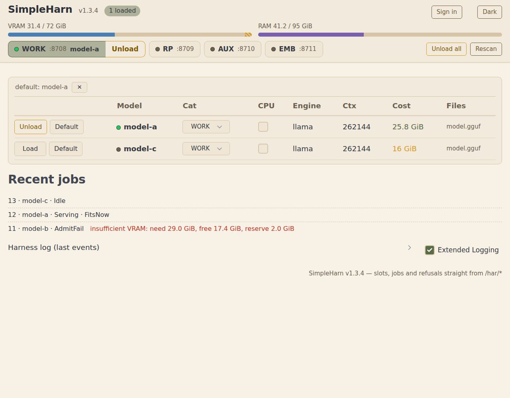

# SimpleHarn

[](https://github.com/legislat/SimpleHarn/actions/workflows/ci.yml)

SimpleHarn is a Windows tray harness for local LLM inference. It runs several inference
engines on one GPU behind one OpenAI-compatible API. One swap scheduler is the only writer
of scheduler state. It admits every model load against the memory the card itself reports,
and it refuses to overcommit. The product name is SimpleHarn, and the repository is
`legislat/SimpleHarn`. The binary is `simpleharn.exe`, the config file is `simpleharn.json`,
and the environment names use the `SIMPLEHARN_` prefix.

Current release: **v1.3.4**. Windows 10/11, one NVIDIA GPU, single user.
Prebuilt binaries: see the GitHub Releases page of this repository. The release
zip holds `simpleharn.exe`, `SimpleHarn.vbs`, `README.md`, `LICENSE`, and
`docs/assets/control-page.png`. Models and engine installs are yours.

> This is a personal harness, built for my own machine and my own setup. Feel free to try
> it out, give feedback, and contribute.



## Who this is for

You run local LLMs on Windows with one NVIDIA GPU. You want several models that swap
quickly, each on its own OpenAI-compatible endpoint, with no console windows to manage.
You want one safe budget manager that never force-loads onto a full GPU and names the
blockers and the numbers on every refusal. You do not want to deal with software juggernauts
with a million different options and built-in chat, downloader, and more.

The `llama` path (llama.cpp) works on any machine that can run `llama-server.exe`. The
`strata`, `basalt`, `maya`, and `ninfer` paths run when their engine is installed; see
[ENGINE-RECIPES.md](docs/reference/ENGINE-RECIPES.md) for the wiring. They are tested on
this operator's machine and may need adjustment elsewhere. Compared with llama-swap, which also swaps models, SimpleHarn
adds a memory-accounting scheduler that refuses to overcommit. What this is not: it is
not multi-user, it is not a router for remote or cloud engines, and it is not a replacement
for llama-swap. It runs and supervises local engines on one machine only.

This software is provided AS-IS, with no warranty of any kind. See
[LICENSE](LICENSE) (Apache-2.0).

## Documentation style

The docs in this repository are written in ASD-STE100 (Simplified Technical English) on
purpose: short sentences, active voice, one idea per sentence. People and software agents
can parse them reliably. The trade is that some pages read terse.

## Quick start

### Prebuilt

1. Download `SimpleHarn-1.3.4-win-x64.zip` from the Releases page and unzip it.
2. Put one flat `.yaml` row in `ModelConf` beside the exe. The harness creates that
   folder on boot if it is missing; it does not create an example row. Ready rows for
   every engine are in [examples/](examples/README.md).
3. Double-click `SimpleHarn.vbs`, open `http://127.0.0.1:8708/`, and load the model.

### From source

You need Rust on Windows. `rust-toolchain.toml` pins the build toolchain to
Rust 1.98.1. rustup installs the pinned toolchain on the first build. The
minimum supported Rust version (MSRV) is 1.88. CI checks the crate on the
MSRV.

```powershell
cargo build --release
```

1. Put one flat `.yaml` file per model in `ModelConf` beside the built exe. The harness
   creates the folder on boot if it is missing. Start from a ready row in
   [examples/](examples/README.md).

   ```yaml
   engine: llama
   model: <path-to-model>.gguf
   category: WORK
   vram_gb: 8.0
   cost: fixed
   context: 8192
   ```

   The filename, for example `example.yaml`, is the model identity. The schema is in
   [MODELS.md](docs/reference/MODELS.md).

2. Run `target\release\simpleharn.exe` with the `ModelConf` folder beside it. First run
   probes the GPU total (NVML), prefers a `llama-server.exe` found on PATH, and records
   the winner. It writes the authoritative `simpleharn.json` beside the exe, and it binds
   loopback only. The binary embeds no engine install path. `llama_server_exe`
   is an optional global default. A llama row may override it for its own
   fork. It never overwrites a config file that already exists. The harness
   ignores an old `simplehar-se.json` or `simplehar.json` file and creates
   `simpleharn.json`.

   To start it without a console window, double-click `SimpleHarn.vbs` beside the exe.
   Run `simpleharn.exe` directly when you want the live tracing console.

3. Open `http://127.0.0.1:8708/`. Load one model on the page. The harness starts that
   model's engine. No engine runs before a load.

The four category listeners on ports 8708-8711 answer the OpenAI-compatible API.

## How it works

- **Single writer.** The scheduler is the only component that changes slot and budget
  state. Every load and unload passes through one decision point.
- **The witness is the budget truth.** Admission reads the live VRAM figure from the card,
  minus a reserve. The harness never books more than the card reports, so it never
  overcommits.
- **Refusals name their reasons.** Every refusal lists the blockers and the numbers, on
  the page and in the API.
- **Eviction is a one-way matrix.** Nothing evicts WORK. Only WORK evicts RP. WORK and RP
  evict AUX and EMB. Same-slot replacement is always allowed. When several victims would
  cover the deficit, the planner takes the cheapest sufficient set.
- **Config file is king.** One JSON file beside the exe plus one flat YAML file per model.
  The catalog reloads on rescan; page edits write back to `simpleharn.json`, and keys that
  bind at boot take effect on restart.

## Categories and ports

| Category | Public port | Slots | Purpose | Evicted by |
|---|---|---|---|---|
| WORK | 8708 | 1 | coding/agent work; also hosts the control page + `/har/*` | nobody |
| RP | 8709 | 1 | roleplay | WORK |
| AUX | 8710 | 1-6 | utility models | WORK, RP |
| EMB | 8711 | 1 | embeddings | WORK, RP |

The four category names are display-only defaults. A `categories` entry can
set an optional `label` to rename what the page and `/har/status` show. The
ids stay the vocabulary: requests, model yamls, and the eviction matrix keep
using them. See [docs/reference/CONFIG.md](docs/reference/CONFIG.md).

The full port plan is in [docs/reference/CONFIG.md](docs/reference/CONFIG.md).

## Control page and tray

The page shows slot cards, memory bars (observed VRAM, the reserve, in-flight bookings,
host RAM), per-model rows with Load and Default, recent jobs, and the harness log. A
rescan re-reads the catalog; a serving model keeps the launch it was spawned with, so an
edit to a live model takes effect on its next load. The tray shows green loaded, yellow
swap in flight, gray idle, or red listener down. The menu offers Open Web UI, the
unload actions, and Exit.

## Configuration

The authoritative `simpleharn.json` sits beside the exe; page edits persist to it. Core
keys:

- `internal_host`: bind address. Default `127.0.0.1`. Read Security before you change it.
- `control_token`: when set, every route except the page assets requires it. The
  `SIMPLEHARN_TOKEN` environment variable overrides it and keeps the secret out of the
  file. The old `SIMPLEHAR_TOKEN` spelling is inert.
- `categories`: per-category id, port, slots, default model, and eviction.
- `vram_total_gb`: admission ceiling. First run normally detects it from the card.
- `modelconf_dir`: catalog directory. Default: a `ModelConf` folder beside the exe.

The full field table is in [docs/reference/CONFIG.md](docs/reference/CONFIG.md). Each
model is one flat `key: value` YAML file in `ModelConf`; the full schema and the engine
knobs are in [docs/reference/MODELS.md](docs/reference/MODELS.md).

## HTTP API

Each public listener answers the OpenAI-style endpoints `/v1/models`,
`/v1/chat/completions`, `/v1/completions`, and `/v1/embeddings`. A request that names no
model goes to the loaded model of that category, or to its `default_model` when nothing is
loaded. The control routes, memory provenance, and error codes are in
[docs/reference/API.md](docs/reference/API.md).

## Security

The API is unauthenticated by default, and it binds to loopback. Set `SIMPLEHARN_TOKEN`
(or `control_token`) before any non-loopback bind. The harness still allows a
non-loopback `internal_host` such as `0.0.0.0` without a token. The control page then
shows a persistent warning banner on every read. Do not expose the harness to a LAN
without a token.

- With a token set, every route except the page assets requires it, on `X-Har-Token` or
  `Authorization: Bearer`. The harness never logs the token and never accepts it from a
  URL.
- The harness forces every engine it starts onto a loopback listener, regardless of
  `internal_host`. The token guards the harness's own listeners only.
- Structural guards run before the token check: a cross-site `Origin` on a POST gets 403,
  and a missing `application/json` content type gets 415.

## Requirements

| Engine | What runs | What the machine needs |
|---|---|---|
| `llama` (default) | a native `llama-server.exe` process per model, serving a GGUF file | a llama.cpp build; first run detects and records a `llama-server.exe` found on PATH; `llama_server_exe` sets an optional global default, and a model row can override it for its own fork |
| `strata` | a Python server in a virtualenv, on a harness-rendered profile | a Strata install with its virtualenv and engine binary; the interpreter and working directory are config keys |
| `basalt` | a Python server in a virtualenv, on a harness-rendered profile | a Basalt install with its virtualenv and engine binary; the row names the interpreter, working directory, and engine |
| `maya` | a Python server in a virtualenv, on a harness-staged model config | a Project Maya install with its virtualenv and engine; the row names the interpreter, root, and model config |
| `ninfer` | a GPU container inside WSL2, staged and reaped by the harness | a WSL2 distro, Docker, and the ninfer image; set `wsl_distro` / `wsl_user` |

GPU memory is read through NVML with an `nvidia-smi` fallback. WSL2 and Docker are needed
only for `ninfer`. One GGUF file is needed per `llama` model. Minimal per-engine setup is
in [ENGINE-RECIPES.md](docs/reference/ENGINE-RECIPES.md).

## Troubleshooting

Common cases: a port that will not bind (a Hyper-V/WSL2 reservation often covers it), a
missing model file at boot (the scan drops the row and reports it), and a repeated
refusal (unload something; the harness never over-admits). The full list, with the
`netsh` fix for reserved ports, is in
[docs/reference/TROUBLESHOOTING.md](docs/reference/TROUBLESHOOTING.md).

## Docs, help, and license

| Topic | Where |
|---|---|
| Agent entry point | [AGENTS.md](AGENTS.md) |
| Binding invariants | [docs/architecture/DOCTRINE.md](docs/architecture/DOCTRINE.md) |
| Architecture overview | [docs/architecture/OVERVIEW.md](docs/architecture/OVERVIEW.md) |
| HTTP API reference | [docs/reference/API.md](docs/reference/API.md) |
| OpenAI compatibility matrix | [docs/reference/COMPATIBILITY.md](docs/reference/COMPATIBILITY.md) |
| Model schema reference | [docs/reference/MODELS.md](docs/reference/MODELS.md) |
| Example model rows | [examples/README.md](examples/README.md) |
| Configuration reference | [docs/reference/CONFIG.md](docs/reference/CONFIG.md) |
| Documentation map | [docs/DOCS_README.md](docs/DOCS_README.md) |
| Contributing | [CONTRIBUTING.md](CONTRIBUTING.md) |
| Changelog | [CHANGELOG.md](CHANGELOG.md) |
| License | [LICENSE](LICENSE) (Apache-2.0) |
| Issues | [legislat/SimpleHarn/issues](https://github.com/legislat/SimpleHarn/issues) |

Found a problem or have an idea? Open an issue. Contributions are welcome; start with
[CONTRIBUTING.md](CONTRIBUTING.md).

## Plans

- Multiple GPU support
- Possible Linux fork
- More engines
- UI and user experience enhancements

## Rename from SimpleHar SE

The project shipped under the working name SimpleHar SE. An unrelated utility named
SimpleHAR, a HAR-file viewer, already used that name. The product, binary, crate, config
file, env names, wire identifiers, and custody dirs are now SimpleHarn. There is no
backward compatibility and no migration. The harness ignores an old `simplehar-se.json`
or `simplehar.json` config file. The old `SIMPLEHAR_*` environment names are inert. The
harness never reads the old wire values or the old `.simplehar` custody dirs.

## Special thanks

- [llama.cpp](https://github.com/ggml-org/llama.cpp)
- [llama-swap](https://github.com/mostlygeek/llama-swap)
- [berth](https://github.com/T-Crypt/berth)
- [Strata](https://github.com/Niko1221/Strata)
- [Basalt](https://github.com/jesdga95/basalt)
- [NInfer](https://github.com/Neroued/ninfer)
- [NInfer-all](https://github.com/iamwavecut/ninfer-all)
- [Project Maya](https://github.com/mw00/project-maya)
